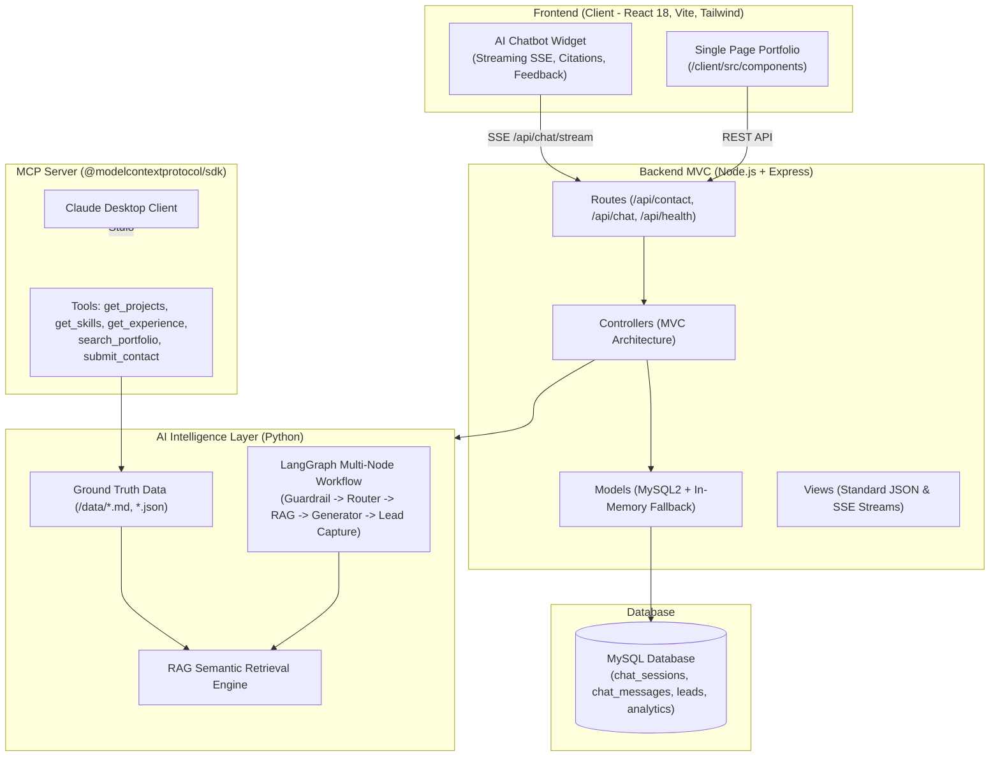

# Ajithkumar E — Full-Stack & AI Software Developer Portfolio

A production-grade developer portfolio featuring an interactive AI Chatbot built with **React (Vite)**, **Tailwind CSS**, a **Node.js Express MVC backend**, a **Python LangChain + LangGraph RAG intelligence layer**, and an official **Model Context Protocol (MCP) server**.

---

## Architecture Overview



---

## Directory Structure

```
├── client/                      # Vite + React (JavaScript, Tailwind CSS, Framer Motion)
│   ├── src/
│   │   ├── components/          # All components in one single folder as requested
│   │   │   ├── About.jsx
│   │   │   ├── ChatWidget.jsx   # AI Chatbot with streaming, chips, citations
│   │   │   ├── constants.js     # Verified profile constants
│   │   │   ├── Contact.jsx
│   │   │   ├── Education.jsx
│   │   │   ├── ErrorBoundary.jsx
│   │   │   ├── Experience.jsx
│   │   │   ├── Footer.jsx
│   │   │   ├── Hero.jsx
│   │   │   ├── Navbar.jsx
│   │   │   ├── Projects.jsx
│   │   │   ├── Skills.jsx
│   │   │   ├── ThemeToggle.jsx
│   │   │   └── useTheme.js
│   │   ├── App.jsx
│   │   ├── main.jsx
│   │   └── index.css
│   ├── index.html
│   └── package.json
│
├── server/                      # Node.js + Express MVC Architecture
│   ├── src/
│   │   ├── controllers/         # contactController, chatController, analyticsController, healthController
│   │   ├── models/              # db, leadModel, chatModel, analyticsModel
│   │   ├── views/               # responseView, chatView
│   │   ├── routes/              # contactRoutes, chatRoutes, analyticsRoutes, healthRoutes, index
│   │   ├── middleware/          # rateLimiter, errorHandler
│   │   ├── db/migrations/       # 001_initial_schema.sql (plain SQL migrations)
│   │   ├── tests/               # Automated integration test suite
│   │   ├── app.js
│   │   └── server.js
│   ├── ai/                      # Python AI Chatbot Layer
│   │   ├── rag_engine.py        # Semantic vector search & embeddings over /data
│   │   ├── graph.py             # LangGraph StateGraph (Guardrail, Router, RAG, Generator, Lead Capture)
│   │   ├── service.py           # Real-time SSE streaming bridge
│   │   └── requirements.txt
│   ├── Dockerfile
│   └── package.json
│
├── mcp-server/                  # Model Context Protocol Server (@modelcontextprotocol/sdk)
│   ├── src/index.js             # Exposes get_projects, get_skills, get_experience, etc.
│   ├── README.md                # Claude Desktop configuration guide
│   └── package.json
│
├── data/                        # Ground-truth source documents for RAG & MCP
│   ├── about-me.md
│   ├── projects.json
│   ├── skills.json
│   ├── experience.md
│   └── resume.json
│
├── .github/workflows/ci-cd.yml  # Automated linting, testing, and build verification
├── docker-compose.yml           # Full-stack Docker orchestration
└── README.md
```

---

## Quickstart & Local Setup

### 1. Prerequisites
- Node.js 18+ (tested on Node v25 / v20)
- Python 3.10+ (tested on Python 3.13)
- MySQL 8.0 (optional — the backend includes an automated in-memory persistence fallback for immediate operation)

### 2. Install & Run Everything

**Terminal 1: Start Backend (Port 5000)**
```bash
cd server
npm install
node src/server.js
```

**Terminal 2: Start Frontend (Port 5173)**
```bash
cd client
npm install
npm run dev
```

Open **`http://localhost:5173`** in your browser.

---

## Automated Verification & Tests

Run the backend and AI integration test suite:
```bash
cd server
npm test
```

This verifies:
- `GET /api/health`: 200 OK
- `POST /api/contact`: Form submission and data validation with Zod
- `POST /api/analytics`: Event tracking
- `POST /api/chat/stream`: Real-time SSE token streaming from the Python LangGraph graph with source citations
- `POST /api/chat/feedback`: Message feedback recording (thumbs up / thumbs down)

---

## Connecting MCP to Claude Desktop

Add this block to your Claude Desktop config file:

- **Windows**: `%APPDATA%\Claude\claude_desktop_config.json`
- **macOS**: `~/Library/Application Support/Claude/claude_desktop_config.json`

```json
{
  "mcpServers": {
    "ajithkumar-portfolio": {
      "command": "node",
      "args": ["<FULL_PATH_TO_WORKSPACE>/mcp-server/src/index.js"]
    }
  }
}
```

---

## Deployment Guide

### Frontend Deployment (Vercel)
1. Push this repository to GitHub.
2. In Vercel, click **Add New Project** and select the repository.
3. Set the **Root Directory** to `client`.
4. Framework Preset: **Vite**.
5. Deploy.

### Backend Deployment (Render or Railway)
1. Deploy using the included `server/Dockerfile`.
2. Set Environment Variables:
   - `PORT=5000`
   - `NODE_ENV=production`
   - `DB_HOST=<YOUR_MYSQL_HOST>`
   - `DB_USER=<YOUR_MYSQL_USER>`
   - `DB_PASSWORD=<YOUR_MYSQL_PASSWORD>`
   - `DB_NAME=portfolio_db`
   - `GEMINI_API_KEY=<YOUR_GEMINI_API_KEY>`

---

## Owner Information
- **Name**: Ajithkumar E
- **Role**: Software Developer (Full-Stack & AI Systems)
- **Email**: ajithkumare101@gmail.com
- **Phone**: +91 6380644382
- **Location**: Pattambi, Kerala, India
- **LinkedIn**: https://www.linkedin.com/in/ajithkumar-e-27894028b
- **GitHub**: https://github.com/ajithkumarf2
